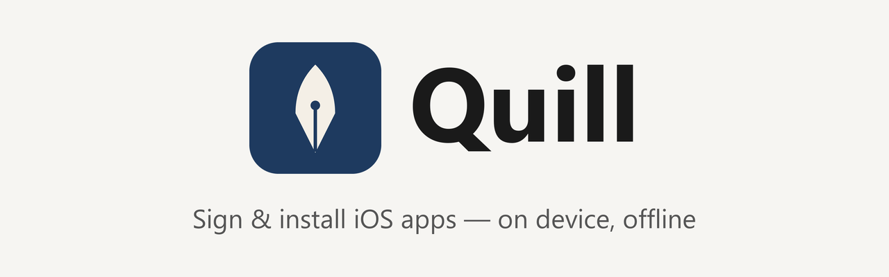

<div align="center">

<picture>
  <source media="(prefers-color-scheme: dark)" srcset="landing-dark.png">
  <source media="(prefers-color-scheme: light)" srcset="landing-light.png">
  
</picture>

</div>

Quill is a personal iOS sideloading app: sign IPAs with your own certificate and install them straight from your device.

## Features

- Sign and install applications.
- Supports [AltStore](https://faq.altstore.io/distribute-your-apps/make-a-source#apps) sources.
- View detailed information about apps and your certificates.
- Configurable signing options for modifying the app.
- Tweak support: inject `.deb` and `.dylib` files using [Ellekit](https://github.com/tealbathingsuit/ellekit).
- No tracking or analytics.

Added in Quill:

- Offline "Fully Local" installs using a Local CA generated on your device.
- Option to delete the signed IPA after installation.
- Source pinning.
- More coming.

## Screenshots

Screenshots coming soon.

<!--
<p align="center"><picture>
  <source media="(prefers-color-scheme: dark)" srcset="demo-dark.png">
  <source media="(prefers-color-scheme: light)" srcset="demo-light.png">
  
</picture></p>
-->

## Getting the IPA

Released builds are on [GitHub Releases](https://github.com/SimonPetrus/Quill/releases). You can also add the Quill source to AltStore, SideStore or Quill itself (it is added in Quill by default):

```
https://raw.githubusercontent.com/SimonPetrus/Quill/source/source.json
```

Development builds: CI places `Quill.ipa` on the `ipa-builds` branch on every push to `quill`, and on `ipa-builds-dev` for every other branch:

```sh
git fetch origin ipa-builds && git show FETCH_HEAD:Quill.ipa > Quill.ipa
```

The IPA is unsigned; sign it with your own method.

## Local CA setup

1. In Quill, open Settings > Installation, set "Server Type" to "Fully Local".
2. Tap "Install Local CA".
3. Download the profile in Safari.
4. On the iPhone, open Settings and tap "Profile Downloaded", then Install.
5. Go to Settings > General > About > Certificate Trust Settings and enable full trust for "Quill Local Root CA".
6. Back in Quill, the status should read "Trusted".

See [How it works](HOW_IT_WORKS.md) for details.

## Updating Quill itself

Updating Quill from within Quill requires the idevice install method; the server method cannot install over the running app. The bundle ID must stay the same, and PPQ must be off.

In Quill: open Sources, pick the Quill source, tap Get, sign the IPA, then install it with the idevice method.

## Building

Requires macOS with Xcode 26:

```sh
git submodule update --init && make iphoneos
```

The result is `packages/Quill.ipa`.

## Credits & License

Quill is based on [Feather](https://github.com/claration/Feather), licensed under GPL-3.0. See [LICENSE](../LICENSE).

---

<div align="center">

<picture>
  <source media="(prefers-color-scheme: dark)" srcset="landing-dark.png">
  <source media="(prefers-color-scheme: light)" srcset="landing-light.png">
  
</picture>

</div>

Quill, kişisel kullanım için bir iOS sideloading uygulamasıdır: IPA'ları kendi sertifikanla imzala ve doğrudan cihazından kur.

## Özellikler

- Uygulamaları imzala ve kur.
- [AltStore](https://faq.altstore.io/distribute-your-apps/make-a-source#apps) kaynaklarını destekler.
- Uygulamalar ve sertifikaların hakkında ayrıntılı bilgi görüntüle.
- Uygulamayı değiştirmek için yapılandırılabilir imzalama seçenekleri.
- Tweak desteği: [Ellekit](https://github.com/tealbathingsuit/ellekit) ile `.deb` ve `.dylib` dosyalarını enjekte et.
- İzleme veya analitik yok.

Quill ile eklenenler:

- Cihazda üretilen Yerel CA ile çevrimdışı "Tamamen Yerel" kurulum.
- Kurulumdan sonra imzalı IPA'yı silme seçeneği.
- Kaynak sabitleme.
- Daha fazlası geliyor.

## Ekran görüntüleri

Ekran görüntüleri yakında.

## IPA'yı edinme

Yayınlanan sürümler [GitHub Releases](https://github.com/SimonPetrus/Quill/releases) sayfasında. Quill kaynağını AltStore, SideStore veya Quill'e ekleyebilirsin (Quill'de varsayılan olarak ekli):

```
https://raw.githubusercontent.com/SimonPetrus/Quill/source/source.json
```

Geliştirme derlemeleri: CI, `quill` dalına her push'ta `Quill.ipa` dosyasını `ipa-builds` dalına, diğer dallar için `ipa-builds-dev` dalına koyar:

```sh
git fetch origin ipa-builds && git show FETCH_HEAD:Quill.ipa > Quill.ipa
```

IPA imzasızdır; kendi yönteminle imzala.

## Yerel CA kurulumu

1. Quill'de Ayarlar > Kurulum ekranında "Sunucu Türü" seçeneğini "Tamamen Yerel" yap.
2. "Yerel CA'yı Yükle" düğmesine dokun.
3. Profili Safari'de indir.
4. iPhone'da Ayarlar'ı aç, "Profil İndirildi"ye dokun ve Yükle'yi seç.
5. Ayarlar > Genel > Hakkında > Sertifika Güven Ayarları'na git ve "Quill Local Root CA" için tam güveni aç.
6. Quill'e dön; durum "Güvenilir" olmalı.

Ayrıntılar için [Nasıl çalışır](HOW_IT_WORKS.md) sayfasına bak.

## Quill'i güncelleme

Quill'i Quill içinden güncellemek için idevice kurulum yöntemi gerekir; sunucu yöntemi çalışan uygulamanın üzerine kurulum yapamaz. Bundle ID aynı kalmalı ve PPQ kapalı olmalı.

Quill içinde: Kaynaklar'dan Quill kaynağını seç, Al'a dokun, IPA'yı imzala, sonra idevice yöntemiyle kur.

## Derleme

macOS ve Xcode 26 gerekir:

```sh
git submodule update --init && make iphoneos
```

Sonuç `packages/Quill.ipa` olur.

## Katkı ve Lisans

Quill, GPL-3.0 lisanslı [Feather](https://github.com/claration/Feather) projesine dayanır. Bkz. [LICENSE](../LICENSE).
